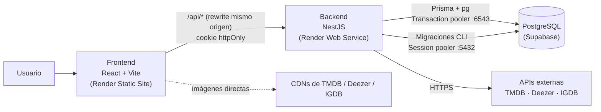

# opinai

Plataforma de reseñas y valoraciones de **películas, series, música (álbumes y canciones) y videojuegos**, con importación bajo demanda desde **TMDB**, **Deezer** e **IGDB**.

> **Proyecto 100 % desarrollado con IA (Claude Opus 5.5)**  
> Todo el código, la arquitectura, las pruebas y la documentación de este repositorio fueron generados íntegramente utilizando **Claude Opus 5.5**.
>
> **Propósito principal: práctica y uso de herramientas de despliegue**  
> **opinai** nació con el objetivo concreto de diseñar, configurar y llevar a producción una aplicación full-stack real utilizando **Supabase** (base de datos PostgreSQL administrada con *connection pooling*) y **Render** (Static Site para el frontend + Web Service en Node.js para el backend, conectados bajo el mismo origen).

---

## Tabla de contenidos

- [Enfoque del proyecto (IA + Deploy)](#enfoque-del-proyecto-ia--deploy)
- [Funcionalidades](#funcionalidades)
- [Stack tecnológico](#stack-tecnológico)
- [Arquitectura de despliegue (Render + Supabase)](#arquitectura-de-despliegue-render--supabase)
- [Estructura del repositorio](#estructura-del-repositorio)
- [Desarrollo local](#desarrollo-local)
- [Guía de despliegue en Supabase y Render](#guía-de-despliegue-en-supabase-y-render)
- [Documentación adicional](#documentación-adicional)

---

## Enfoque del proyecto (IA + Deploy)

1. **Construcción íntegra con Claude Opus 5.5**: desde el modelado de datos en Prisma y los módulos de NestJS hasta la interfaz en React, el proyecto explora un flujo de desarrollo guiado completamente por IA manteniendo buenas prácticas (validación estricta, manejo uniforme de errores, tests unitarios/e2e y documentación viva).
2. **Pensado para desplegar en Supabase + Render**: muchas decisiones técnicas del repositorio existen específicamente para resolver escenarios reales de producción en estas dos plataformas:
   - Separación entre `DATABASE_URL` (*Transaction pooler* de Supabase, puerto `6543`) y `DIRECT_URL` (*Session pooler* de Supabase, puerto `5432` compatible con IPv4 para migraciones de Prisma).
   - Regla *rewrite* en el Static Site de Render (`/api/*` hacia el Web Service) para que frontend y backend compartan origen y las cookies de sesión `httpOnly` (`__Host-opinai_sid`, `SameSite=Lax`) funcionen sin problemas de cookies de terceros.
   - `TRUST_PROXY`, `CORS_ORIGINS`, `NODE_ENV` obligatoria al arranque, *graceful shutdown hooks* para cierres limpios en Render y *health check* en `GET /api/health`.
   - Protección en `prisma/seed.ts` (`seed-guard.ts`) que impide ejecutar el *seed* destructivo contra bases remotas como Supabase o con `NODE_ENV=production`.

---

## Funcionalidades

- **Catálogo por categorías**: películas, series, música (álbumes y canciones) y videojuegos, con ordenamiento y paginación.
- **Importación bajo demanda desde APIs externas**:
  - **TMDB**: búsqueda e importación de películas y series (en `es-CL`).
  - **Deezer**: búsqueda e importación de álbumes (con todas sus canciones) y canciones (con su álbum), deduplicando por ISRC.
  - **IGDB**: búsqueda e importación de videojuegos con credenciales de Twitch.
- **Reseñas y valoraciones**: puntuación de 0,5 a 5 estrellas (1–10 en la API), reseñas con texto o solo nota, ocultación de *spoilers* y recálculo transaccional de promedios.
- **Perfiles de usuario**: perfil público (`/usuario/:username`) con estadísticas e historial de reseñas filtrable por tipo, contenido y orden.
- **Autenticación propia**: registro, inicio y cierre de sesión con `argon2id` y sesiones persistidas en PostgreSQL mediante cookie `httpOnly`.

---

## Stack tecnológico

| Capa | Tecnologías |
|---|---|
| **Frontend** | React 19, Vite 8, TypeScript 7, React Router 8, CSS con tema claro/oscuro |
| **Backend** | NestJS 12 (ESM, Express), TypeScript 6, Zod 4 (`StandardSchemaValidationPipe`), Swagger (`/api/docs` fuera de producción), `@nestjs/throttler`, `@nestjs/terminus` |
| **Base de datos y ORM** | PostgreSQL 17 (local) / Supabase (producción), Prisma 7 con `@prisma/adapter-pg` |
| **Seguridad** | `argon2` (argon2id), cookies `httpOnly`, `OriginGuard` (CSRF), rate limiting por IP y bloqueo temporal por cuenta |
| **Testing y calidad** | Vitest 4 (unitarios y e2e), `oxlint`, Prettier |
| **Infraestructura y deploy** | Docker Compose (solo Postgres local), **Supabase** (PostgreSQL), **Render** (Static Site + Web Service Node 22) |

---

## Arquitectura de despliegue (Render + Supabase)



- **Sin Docker en producción**: Render construye y ejecuta tanto el frontend estático como el Web Service del backend de forma nativa con Node.js.
- **Imágenes desde CDN**: no se almacenan archivos binarios en el servidor; se guardan las URLs de portada/fondo y el navegador las carga directamente desde los CDNs de cada proveedor.

---

## Estructura del repositorio

```text
opinai/
├── architecture.md          # Documentación técnica detallada de toda la arquitectura
├── docker-compose.yml       # PostgreSQL 17 para desarrollo local (puerto 5433)
├── backend/                 # API REST en NestJS + Prisma 7
│   ├── prisma/              # schema.prisma, migraciones SQL y seed.ts
│   ├── src/                 # Módulos (auth, media, reviews, users, creators, genres, integrations, health)
│   ├── test/                # Tests e2e
│   └── .env.example         # Plantilla de variables de entorno
└── frontend/                # SPA en React + Vite
    └── src/                 # Páginas, componentes, auth y cliente /api
```

---

## Desarrollo local

### Requisitos previos

- **Node.js 22** y `npm`
- **Docker** y Docker Compose (para levantar PostgreSQL localmente)

### 1. Levantar la base de datos

```bash
docker compose up -d
```

Expone PostgreSQL 17 en `localhost:5433` (usuario `opinai`, contraseña `opinai`, base `opinai`).

### 2. Configurar y arrancar el backend

```bash
cd backend
cp .env.example .env
npm install
npm run db:migrate
npm run db:generate
npm run db:seed
npm run start:dev
```

- La API queda disponible en `http://localhost:3000/api`.
- La documentación interactiva de Swagger queda en `http://localhost:3000/api/docs`.
- El *seed* crea datos de ejemplo y tres usuarios (`admin@opinai.local`, `ana@opinai.local`, `bruno@opinai.local`, todos con contraseña `opinai123`).
- Si quieres probar las importaciones de películas/series o videojuegos en local, añade `TMDB_ACCESS_TOKEN` y/o `IGDB_CLIENT_ID` + `IGDB_CLIENT_SECRET` en `backend/.env` (Deezer funciona sin credenciales).

### 3. Arrancar el frontend

En otra terminal:

```bash
cd frontend
npm install
npm run dev
```

La aplicación web queda disponible en `http://localhost:5173`. Vite redirige automáticamente las llamadas a `/api` hacia `http://localhost:3000`.

### Comandos útiles

| Carpeta | Comando | Descripción |
|---|---|---|
| `backend/` | `npm test` / `npm run test:e2e` | Ejecuta tests unitarios / e2e con Vitest |
| `backend/` | `npm run lint` / `npm run format` | Linter (`oxlint`) / formateo (`prettier`) |
| `backend/` | `npm run db:studio` | Abre Prisma Studio |
| `frontend/` | `npm run build` / `npm run lint` | Compila a `dist/` / ejecuta `oxlint` |

---

## Guía de despliegue en Supabase y Render

### 1. Base de datos en Supabase

1. Crea un proyecto en **Supabase**.
2. En **Project Settings → Database → Connection string**, obtén las dos URLs de conexión:
   - **Transaction pooler (puerto `6543`)**: úsala como `DATABASE_URL` (añadiendo `?pgbouncer=true` si corresponde según tu configuración de pooler).
   - **Session pooler (puerto `5432`)**: úsala como `DIRECT_URL` (compatible con IPv4 para `prisma migrate deploy`).

### 2. Backend en Render (Web Service)

Crea un **Web Service** apuntando al repositorio con:

- **Root Directory**: `backend`
- **Runtime**: Node (22)
- **Build Command**:
  ```bash
  npm ci && npx prisma migrate deploy && npm run build
  ```
  *(El script `postinstall` del backend ya ejecuta `prisma generate` automáticamente.)*
- **Start Command**:
  ```bash
  npm run start:prod
  ```
- **Health Check Path**: `/api/health`

**Variables de entorno en Render (Backend)**:

| Variable | Valor recomendado |
|---|---|
| `NODE_ENV` | `production` |
| `DATABASE_URL` | Connection string de Supabase (*Transaction pooler*, puerto `6543`) |
| `DIRECT_URL` | Connection string de Supabase (*Session pooler*, puerto `5432`) |
| `CORS_ORIGINS` | URL pública del Static Site en Render (p. ej. `https://opinai.onrender.com`) |
| `TRUST_PROXY` | `1` *(para leer la IP real del cliente detrás del proxy de Render)* |
| `TMDB_ACCESS_TOKEN` | *(Opcional)* Token de lectura de TMDB |
| `IGDB_CLIENT_ID` | *(Opcional)* Client ID de Twitch para IGDB |
| `IGDB_CLIENT_SECRET` | *(Opcional)* Client Secret de Twitch para IGDB |

> Nota: `COOKIE_SECURE` toma `true` automáticamente cuando `NODE_ENV=production`.

### 3. Frontend en Render (Static Site)

Crea un **Static Site** apuntando al repositorio con:

- **Root Directory**: `frontend`
- **Build Command**:
  ```bash
  npm ci && npm run build
  ```
- **Publish Directory**: `dist`

**Reglas de Rewrite en Render (en este orden exacto)**:

1. **Proxy de API (mismo origen)**:
   - Source: `/api/*`
   - Destination: `https://<tu-backend>.onrender.com/api/*`
   - Action: `Rewrite`
2. **Fallback SPA (React Router)**:
   - Source: `/*`
   - Destination: `/index.html`
   - Action: `Rewrite`

> La primera regla garantiza que el navegador envíe la cookie de sesión `__Host-opinai_sid` (`SameSite=Lax`) al backend sin restricciones entre subdominios de `onrender.com`.

---

## Documentación adicional

Para ver en detalle los módulos, convenciones REST, modelo de datos, decisiones de diseño y estado del proyecto, consulta [`architecture.md`](architecture.md).
